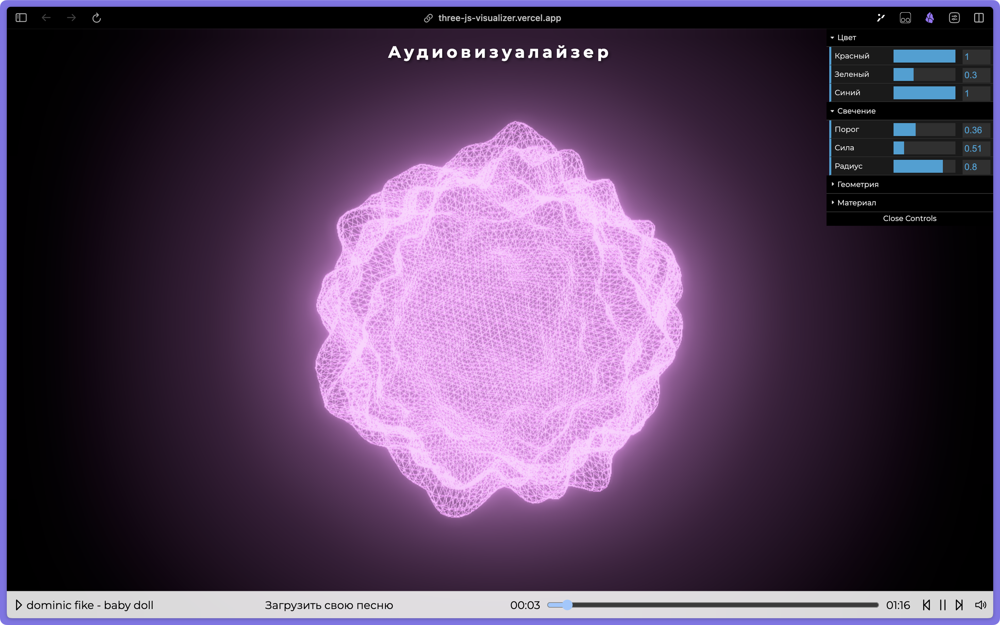

# 3D audio visualizer

Music, drawn in three dimensions from the live audio stream. Three.js for the scene, Web Audio API for the analyser, Vue for the controls.

**Try it:** https://three-js-visualizer.vercel.app/



## Stack

TypeScript, Vue 3, Pinia, Three.js, Web Audio API, PrimeVue, PrimeFlex, PrimeIcons, Vite, Yarn, ESLint and Prettier.

## Run

```bash
git clone https://github.com/nikgritenok/three-js-visualizer.git
cd three-js-visualizer
yarn install
yarn dev
```

The browser asks for a file or microphone before the first frame draws, since the analyser needs a source.
